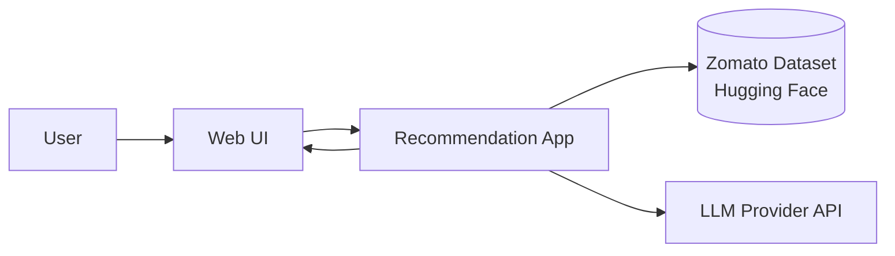
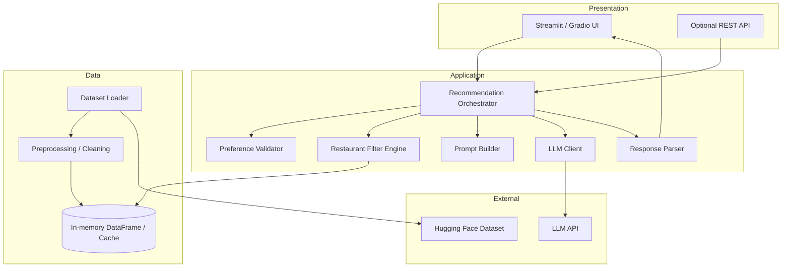
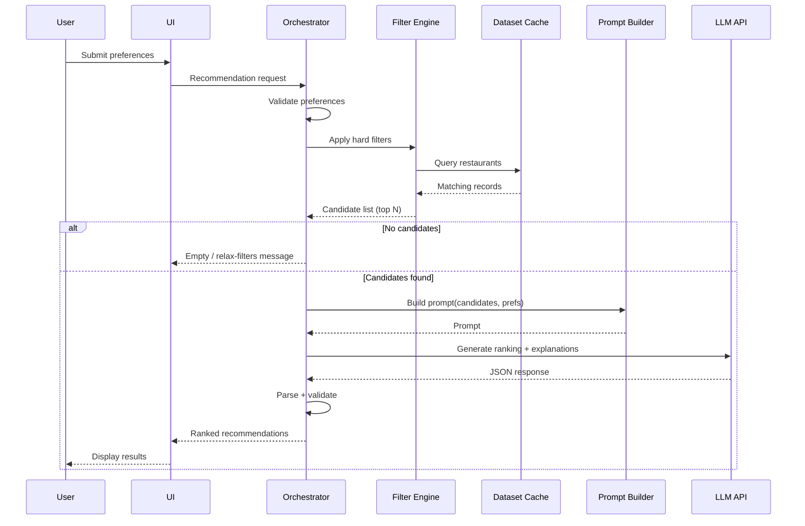

# Architecture

## AI-Powered Restaurant Recommendation System (Zomato Use Case)

This document defines the end-to-end architecture for the personalized restaurant recommendation service described in [`problemStatement.md`](./problemStatement.md).

---

## 1. High-Level Overview

The system is a **filter-then-reason** pipeline:

1. Load and clean the Zomato Bangalore restaurant dataset.
2. Collect structured + free-text user preferences.
3. Deterministically filter restaurants to a short candidate list.
4. Send candidates + preferences to an LLM for ranking and explanations.
5. Render ranked results in a user-facing UI.

```text
┌─────────────┐    ┌──────────────┐    ┌─────────────────┐    ┌──────────────┐    ┌─────────────┐
│ Data Source │───▶│ Data Layer   │───▶│ Filtering Layer │───▶│ LLM Engine   │───▶│ Presentation│
│ Hugging Face│    │ Load/Clean   │    │ Rule-based      │    │ Rank/Explain │    │ UI / API    │
└─────────────┘    └──────────────┘    └─────────────────┘    └──────────────┘    └─────────────┘
                                              ▲
                                              │
                                       ┌──────┴──────┐
                                       │ User Prefs  │
                                       │ Form / API  │
                                       └─────────────┘
```

**Design principle:** Use deterministic filters for hard constraints (location, budget, rating, cuisine). Use the LLM only for soft ranking, personalization, and natural-language explanations. This keeps cost, latency, and hallucination risk low.

---

## 2. System Context



| Actor / System | Role |
| --- | --- |
| User | Submits preferences and views ranked recommendations |
| Web UI | Collects input and displays results |
| Recommendation App | Orchestrates filtering, prompting, and response parsing |
| Hugging Face Dataset | Source of restaurant records |
| LLM Provider | Ranks candidates and generates explanations |

---

## 3. Logical Architecture



---

## 4. Component Details

### 4.1 Presentation Layer

**Responsibility:** Collect preferences and display ranked recommendations.

**Inputs collected:**

| Field | Type | Example |
| --- | --- | --- |
| Location | string / dropdown | `Koramangala`, `Indiranagar` |
| Budget | enum | `low` / `medium` / `high` |
| Cuisine | string / multi-select | `Italian`, `Chinese` |
| Minimum rating | float | `4.0` |
| Additional preferences | free text | `family-friendly`, `quiet ambience` |

**Outputs displayed:**

- Restaurant name
- Cuisine
- Rating
- Estimated cost
- AI-generated explanation
- Optional short overall summary

**Suggested UI:** Streamlit or Gradio for fast bootcamp iteration.

---

### 4.2 Data Layer

**Responsibility:** Ingest, clean, and expose restaurant records for filtering.

**Source:**  
[ManikaSaini/zomato-restaurant-recommendation](https://huggingface.co/datasets/ManikaSaini/zomato-restaurant-recommendation)

**Core fields to extract / normalize:**

| Field | Usage |
| --- | --- |
| `name` | Display + LLM context |
| `location` / `listed_in(city)` | Location filter |
| `cuisines` | Cuisine filter |
| `approx_cost(for two people)` | Budget mapping |
| `rate` | Minimum rating filter |
| `rest_type` | Soft preference matching |
| `dish_liked` | Explanation enrichment |
| `votes` | Ranking signal / popularity |
| `online_order` / `book_table` | Soft preference matching |

**Preprocessing steps:**

1. Load dataset via Hugging Face `datasets` or local CSV/Parquet cache.
2. Drop irrelevant / sparse columns if unused.
3. Normalize ratings (e.g., `"4.1/5"` → `4.1`).
4. Normalize cost to numeric (handle commas).
5. Split and lowercase cuisines for matching.
6. Handle missing values (`rate`, `cuisines`, `approx_cost`).
7. Optionally cache cleaned data locally for faster reloads.

---

### 4.3 Preference & Filtering Layer

**Responsibility:** Enforce hard constraints before calling the LLM.

**Budget mapping (example):**

| Budget | Approx cost for two |
| --- | --- |
| Low | ≤ 500 |
| Medium | 501 – 1000 |
| High | > 1000 |

**Filtering rules:**

1. Match location (exact or fuzzy / contains).
2. Match cuisine (any overlap with selected cuisines).
3. Apply minimum rating threshold.
4. Apply budget band using cost-for-two.
5. Cap candidates (e.g., top 10–20 by rating/votes) before LLM call.

**Why this layer exists:**

- Reduces token usage
- Improves latency
- Prevents the LLM from inventing restaurants outside the dataset
- Guarantees hard constraints are respected

---

### 4.4 Integration / Prompt Layer

**Responsibility:** Convert filtered candidates + user preferences into a structured LLM prompt.

**Prompt contents:**

1. System role: restaurant recommendation assistant grounded only in provided data.
2. User preferences (structured + free text).
3. Candidate restaurant list as compact JSON/CSV-like rows.
4. Output schema instructions (ranked list + explanations + optional summary).

**Prompt design rules:**

- Instruct the model to use **only** the provided restaurants.
- Ask for ranking criteria tied to preferences.
- Require a short explanation per restaurant.
- Request machine-readable JSON for reliable parsing.
- Keep candidate payload small and consistent.

**Example output schema:**

```json
{
  "summary": "Best matches for Italian dining in Koramangala under a medium budget.",
  "recommendations": [
    {
      "rank": 1,
      "name": "Truffles",
      "cuisine": "Italian, Continental",
      "rating": 4.4,
      "estimated_cost": 800,
      "explanation": "Strong Italian options, high rating, and fits medium budget."
    }
  ]
}
```

---

### 4.5 Recommendation Engine (LLM)

**Responsibility:** Rank candidates and generate human-like explanations.

**LLM tasks:**

- Soft ranking across preference fit, rating, cost alignment, and free-text cues
- Natural-language explanations
- Optional summary of the recommendation set

**Non-LLM responsibilities (kept outside the model):**

- Dataset loading
- Hard constraint filtering
- UI rendering
- Schema validation / fallbacks

**Client behavior:**

1. Send prompt to LLM API.
2. Receive completion.
3. Parse JSON.
4. Validate names against candidate set.
5. Fall back to rating-sorted list if parsing fails.

---

### 4.6 Orchestrator

**Responsibility:** Coordinate the request lifecycle.

```text
validate preferences
  → filter restaurants
  → build prompt
  → call LLM
  → parse + validate response
  → return display payload
```

**Edge cases:**

| Case | Behavior |
| --- | --- |
| No restaurants match filters | Return empty-state message; suggest relaxing constraints |
| Too many matches | Truncate to top-N by rating/votes before LLM |
| LLM timeout / error | Fall back to deterministic top-N ranked by rating |
| Invalid LLM JSON | Retry once or fall back to deterministic ranking |
| Hallucinated restaurant names | Drop invalid rows; keep only names present in candidates |

---

## 5. End-to-End Data Flow



---

## 6. Suggested Project Structure

```text
Zomato/
├── Docs/
│   ├── problemStatement.md
│   └── architecture.md
├── data/
│   ├── raw/                  # optional local raw dump
│   └── processed/            # cleaned cache (parquet/csv)
├── src/
│   ├── app.py                # UI entrypoint
│   ├── config.py             # env vars, budget bands, top-N
│   ├── data/
│   │   ├── loader.py         # Hugging Face / local load
│   │   └── preprocess.py     # cleaning + normalization
│   ├── filters/
│   │   └── restaurant_filter.py
│   ├── llm/
│   │   ├── client.py         # provider wrapper
│   │   ├── prompts.py        # prompt templates
│   │   └── parser.py         # response validation
│   ├── services/
│   │   └── recommender.py    # orchestrator
│   └── models/
│       └── schemas.py        # preference + recommendation schemas
├── .env.example
├── requirements.txt
└── README.md
```

---

## 7. Technology Stack (Recommended)

| Layer | Technology | Purpose |
| --- | --- | --- |
| Language | Python 3.10+ | Core implementation |
| UI | Streamlit or Gradio | Preference form + results view |
| Data | `datasets`, pandas | Load and filter restaurants |
| Validation | Pydantic | Preference + LLM response schemas |
| LLM | Groq (`openai/gpt-oss-20b`) | Ranking + explanations |
| Config | `.env` + `python-dotenv` | API keys and runtime settings |
| Optional cache | Parquet / local CSV | Faster reloads during development |

---

## 8. Configuration & Secrets

| Config | Description |
| --- | --- |
| `LLM_API_KEY` | Groq API key (alias: `GROQ_API_KEY`) |
| `LLM_MODEL` | Groq model name (default: `openai/gpt-oss-20b`) |
| `LLM_DRY_RUN` | If `true`, skip live API and return mock JSON |
| `DATASET_ID` | Hugging Face dataset identifier |
| `TOP_N_CANDIDATES` | Max restaurants sent to LLM |
| `TOP_K_RESULTS` | Max recommendations shown |
| `BUDGET_LOW_MAX` / `BUDGET_MED_MAX` | Budget thresholds |
| `REQUEST_TIMEOUT` | LLM call timeout |

Secrets must never be committed. Use `.env` locally and environment variables in deployment.

---

## 9. Non-Functional Architecture

### Performance

- Cache cleaned dataset in memory after first load.
- Filter before LLM to minimize tokens.
- Limit candidates to a fixed top-N.

### Reliability

- Deterministic fallback ranking if LLM fails.
- Strict JSON schema validation.
- Reject recommendations not present in the filtered candidate set.

### Cost Control

- Prefer short structured prompts.
- Avoid sending full dataset to the LLM.
- Cap retries.

### Observability

- Log filter counts (input → matches → candidates).
- Log LLM latency and parse success/failure.
- Do not log full API keys or unnecessary PII.

### Extensibility

- Swap LLM providers behind `llm/client.py`.
- Add embedding retrieval later without changing the UI contract.
- Extend preference schema without rewriting the orchestrator.

---

## 10. Future Enhancements (Optional)

| Enhancement | Description |
| --- | --- |
| Semantic retrieval | Use embeddings to retrieve candidates before LLM ranking |
| Conversation memory | Multi-turn refinement of recommendations |
| Map view | Show restaurant locations geographically |
| Review summarization | Condense user reviews into pros/cons |
| REST API | Expose `/recommend` for mobile / external clients |
| Evaluation harness | Offline tests for filter accuracy and explanation quality |

---

## 11. Architecture Decision Summary

| Decision | Choice | Rationale |
| --- | --- | --- |
| Retrieval strategy | Rule-based filter first | Enforces hard constraints cheaply and reliably |
| Ranking strategy | LLM over shortlist | Better personalization and explanations |
| Grounding | Candidates-only prompting | Reduces hallucination |
| UI | Lightweight Python web UI | Fast to build for bootcamp scope |
| Data handling | Clean once, reuse in memory | Improves responsiveness |
| Failure mode | Deterministic fallback | Keeps product usable when LLM is unavailable |

---

## 12. Alignment with Problem Statement

| Problem Statement Step | Architecture Component |
| --- | --- |
| Data Ingestion | Data Layer (`loader` + `preprocess`) |
| User Input | Presentation Layer |
| Integration Layer | Filter Engine + Prompt Builder |
| Recommendation Engine | LLM Client + Response Parser |
| Output Display | UI results view |

This architecture implements the required workflow while keeping the system modular, testable, and practical to build as an Applied AI project.
